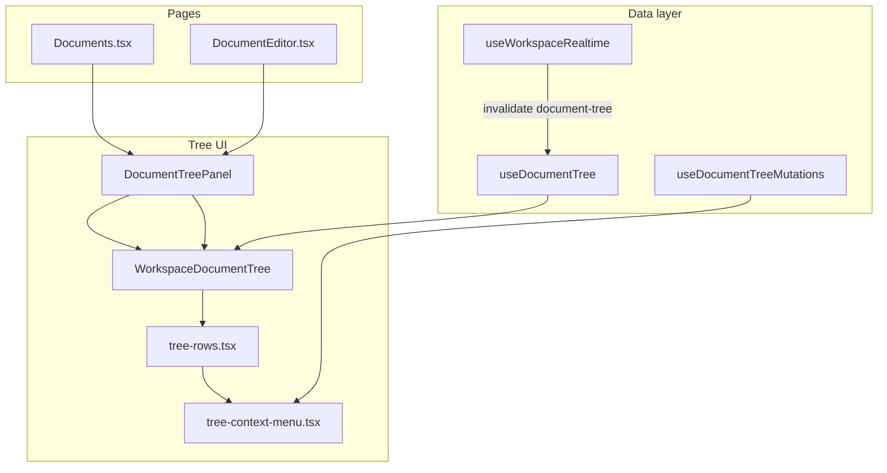

# Document tree and workspace content RBAC (agent-ref)

## Purpose
Reference for the unified workspace document tree (Documents page + Document Editor sidebar), permission model, API enforcement, and cache/realtime sync.

## Canonical sources
- `packages/shared/src/collab/workspace-content-policy.ts`
- `apps/api/src/folders/folders.service.ts`, `folders.nest.controller.ts`
- `apps/api/src/documents/documents.service.ts`
- `apps/web/src/features/documents/components/document-tree.tsx`
- `apps/web/src/features/documents/hooks/use-document-tree.ts`
- `apps/web/src/hooks/use-workspace-realtime.ts`

## Role matrix

| Action | Minimum role |
|--------|----------------|
| Create folder / document | MEMBER |
| Rename / move folder or document | MEMBER |
| Delete folder / draft document | MANAGER |
| Lock / unlock (editor) | MANAGER+ (see editor) |

VIEWER: read-only; organize/create/delete UI hidden; API returns `INSUFFICIENT_ROLE` (403).

## Web architecture

### Key modules
- **`WorkspaceDocumentTree`** — `variant`: `page` | `sidebar`; search/status filter via `filterTree`.
- **`documentTreeQueryKey(workspaceId)`** — React Query key; use `invalidateDocumentTree` after mutations.
- **`treePermissions`** — `{ canCreateContent, canOrganizeContent, canDeleteContent }`; must be computed **before** any conditional return in `DocumentEditor.tsx` (Rules of Hooks).

### Empty folders
`filterTree` in `document-tree-filter.ts` must not hide empty folders when there is no active search or status filter.

## API

- `GET /api/v1/workspaces/:workspaceId/documents/tree` — tree payload
- `POST/PATCH/DELETE .../folders` — guarded by `@WorkspaceRoleAtLeast` and `FoldersService` policy checks
- Realtime events: `workspace:folder_created`, `workspace:folder_updated`, `workspace:folder_deleted`, `workspace:document_*` (invalidate tree on web)

## Dev pitfalls

1. **API not on 3001** — If Nest fails at boot (e.g. duplicate import in `folders.nest.controller.ts`), every page shows "Failed to fetch". Verify `curl http://127.0.0.1:3001/api/v1/health`.
2. **Hooks order in DocumentEditor** — Never place `useMemo`/`useState` after `if (state.status === "loading") return ...`.
3. **Host alignment** — Use `http://127.0.0.1:8080` and `127.0.0.1` API base for cookies/OAuth.

## Tests
- `tests/unit/document-tree-filter.test.ts`
- `tests/unit/workspace-content-policy.test.ts`
- `tests/integration/nest-api-http.test.ts` (folder RBAC cases)
