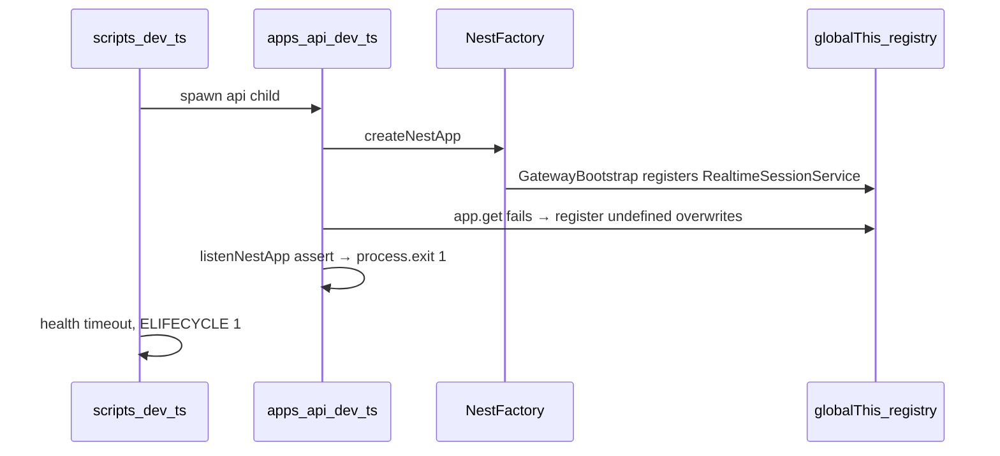

# Session: Collab + Realtime Deep Fix (2026-05-21)

This document records the collaborative editing (Hocuspocus/Yjs) and Socket.IO realtime work, how problems were diagnosed, what was changed, and how to verify locally.

## Symptoms (before fix)

| Area | Symptom |
|------|---------|
| **Document editor** | Footer showed offline/unsaved; typing did not sync across browsers |
| **Browser console** | `[collab] connect timed out`; awareness `count: 1`; WebSocket closed before established |
| **Collab server** | Often no `[collab] client connecting` / `[collab][auth] ok` despite server listening on 3002 |
| **API terminal** | `RealtimeSessionService is not available on this gateway instance (DI misconfiguration)` |
| **`pnpm dev`** | API exited after start with `RealtimeSessionService is not wired`; health poll failed; Vite never started |

## Debug evidence (session `833b60`)

Runtime logs showed two independent failure modes:

1. **Hocuspocus client lifecycle** — `connect-start` ran but `connect-timeout` followed ~4s later; collab auth logs were absent (handshake/path/lifecycle).
2. **Socket.IO DI** — `resolveSessionService` fallbacks were empty (`hasRegistry: false`, `hasStatic: false`, `hasModuleRef: false`) on handler instances Nest creates without constructor injection.

## Root causes

### A. Hocuspocus WebSocket URL

Hocuspocus v4 listens on the **TCP port root** (`ws://127.0.0.1:3002`), not a SPA-style path like `/collab`. Misconfigured `VITE_COLLAB_WS_URL=ws://127.0.0.1:3002/collab` prevented a successful handshake.

### B. Provider lifecycle (v3 design)

`use-collaborative-document-editor` created `HocuspocusProvider` in render with `token: ""`, fetched the token later, and called `provider.disconnect()` on bootstrap effect cleanup — racing Strict Mode and aborting in-flight connects.

### C. Socket.IO `RealtimeSessionService` resolution

Nest WebSocket invokes handlers on proxy instances **without** constructor DI. Class statics and a module-level registry were insufficient when duplicate ESM class identities appeared under `tsx watch`.

### D. Dev server kill switch (critical for `pnpm dev`)

In `nest-app-bootstrap.ts`, `app.get(RealtimeSessionService)` returned `undefined` (duplicate class token under `tsx`). That called `registerRealtimeSessionService(undefined)`, **overwriting** the valid registration from `RealtimeGatewayBootstrap.onModuleInit`. The post-listen dev assert then called `process.exit(1)`, so `scripts/dev.ts` never started web/collab/worker.



## Fixes implemented

### Track A — Hocuspocus / document editor

| Change | File(s) |
|--------|---------|
| Default WS URL `ws://127.0.0.1:3002` (no `/collab`) | `apps/web/src/lib/collab-ws-url.ts`, `.env.example`, `apps/web/.env.example`, `apps/collab/README.md` |
| **v3 deferred provider**: fetch `collab-token` first, then create `Y.Doc` + `HocuspocusProvider` with token+URL; single bootstrap effect keyed on `[sessionKey]`; cleanup clears timers only (no `disconnect()` on re-run) | `apps/web/src/hooks/use-collaborative-document-editor.ts` |
| Collab bootstrap / editor wiring | `collab-bootstrap.ts`, `DocumentEditor.tsx`, `editor-status-bar.tsx` |
| Dev collab JWT TTL extended in dev | `apps/api/src/auth/auth-session.service.ts` |
| Collab server bootstrap + auth extension | `apps/collab/src/main.ts`, `apps/collab/src/extensions/auth.extension.ts` |

### Track B — Socket.IO realtime DI

| Change | File(s) |
|--------|---------|
| `globalThis` registry for `INestApplication` + `RealtimeSessionService` | `apps/api/src/realtime/realtime-session.registry.ts` (new) |
| Register on bootstrap; resolve via registry → Nest app → ModuleRef → statics | `apps/api/src/nest-app-bootstrap.ts`, `apps/api/src/realtime/realtime.gateway.ts` |
| `RealtimeGatewayBootstrap` registers fallbacks on `onModuleInit` / `onApplicationBootstrap` | `apps/api/src/realtime/realtime-gateway.bootstrap.ts` (new), `realtime.nest.module.ts` |
| Post-listen dev assert: success if **any** resolution path works | `listenNestApp` in `nest-app-bootstrap.ts` |
| Unit tests: bare gateway + global registry + Nest app global | `tests/unit/api-realtime-gateway.test.ts` |

### Track C — Dev server not starting

| Change | Detail |
|--------|--------|
| `resolveRealtimeSessionService(app)` | Tries registry → `ModuleRef.get()` → `app.get()` |
| Register only when non-null | Avoids overwriting `RealtimeGatewayBootstrap` registration with `undefined` |
| Gateway `resolveSessionService` | Prefers `getNestApplication()?.get(ModuleRef)` before direct `app.get()` |

### Other touched areas

- `scripts/dev.ts` — minor dev orchestration
- `apps/web/package.json` — collab/editor dependencies
- Anchor decorations, routing, realtime payloads — related editor/realtime UX hardening

## Verification checklist

1. **Env** (repo root `.env`):
   - `VITE_COLLAB_WS_URL=ws://127.0.0.1:3002`
   - `COLLAB_WS_URL=ws://127.0.0.1:3002`
   - `CORS_ORIGINS` includes `http://127.0.0.1:8080` and `http://localhost:8080`

2. **Start stack**:
   ```bash
   pnpm dev
   ```
   Expect:
   - `[api] RealtimeSessionService wired for WebSocket handlers`
   - `[dev] API is healthy`
   - Vite at `http://127.0.0.1:8080`
   - Collab on port 3002

3. **Collab** (two browsers, same document):
   - Terminal: `[collab] client connecting`, `[collab][auth] ok`
   - Browser: `[collab] provider connect` → `provider synced`
   - Awareness `count: 2`; footer connected/synced

4. **Tests**:
   ```bash
   pnpm exec tsx --tsconfig apps/api/tsconfig.json --test tests/unit/api-realtime-gateway.test.ts
   ```
   Expect 12/12 pass.

5. **Health**:
   - `curl http://127.0.0.1:3001/api/v1/health` → 200
   - `curl http://127.0.0.1:3002/health` → 200

## Known operational notes

- **Docker port 5432**: If `pnpm dev` fails with “port already allocated”, stop the other Postgres or retry once compose containers are healthy.
- **API port 3001 in use**: Stop stale API before restarting `pnpm dev`.
- **Remaining issues**: User confirmed Hocuspocus integration is largely working; some features may still need follow-up (document in next session after user feedback).

## Key files reference

| Purpose | Path |
|---------|------|
| Collab hook (v3 lifecycle) | `apps/web/src/hooks/use-collaborative-document-editor.ts` |
| WS URL normalization | `apps/web/src/lib/collab-ws-url.ts` |
| API bootstrap + assert | `apps/api/src/nest-app-bootstrap.ts` |
| Realtime registry | `apps/api/src/realtime/realtime-session.registry.ts` |
| Realtime gateway | `apps/api/src/realtime/realtime.gateway.ts` |
| Gateway bootstrap | `apps/api/src/realtime/realtime-gateway.bootstrap.ts` |
| Collab server | `apps/collab/src/main.ts`, `apps/collab/src/extensions/auth.extension.ts` |
| Gateway tests | `tests/unit/api-realtime-gateway.test.ts` |

## Architecture (two realtime channels)

- **Hocuspocus** (`ws://127.0.0.1:3002`) — Yjs document sync + awareness (editor cursors, presence in document header).
- **Socket.IO** (`/realtime` on API) — workspace/task/document rooms, notifications-style events; separate from Hocuspocus.

Both required stable API startup (`pnpm dev`) and correct collab WS URL for end-to-end editor collaboration.

## Follow-up: Remote collaboration cursors (2026-05-21)

### Symptom

Document sync and online presence worked; remote **caret/cursor** positions did not appear in other browsers when users moved to different sections.

### Root cause

1. `useEditor` ran before `HocuspocusProvider` existed (refs only), so the first editor instance often lacked `CollaborationCursor`.
2. TipTap `CollaborationCursor` does not ship CSS — carets/selections could render invisibly without global styles.

### Fix

| Change | File |
|--------|------|
| `collabSession` React state; gate `useEditor` until `{ ydoc, provider }` ready; `Collaboration.configure({ document: provider.document })` | `use-collaborative-document-editor.ts` |
| `editor.commands.updateUser()` + `setProviderAwarenessUser` after editor mounts | same |
| DEV `logAwarenessCursorsDev` on awareness change | same |
| Export `sessionVersion` for remount key | same |
| Collaboration cursor + selection CSS | `index.css` |
| Standard `.collaboration-cursor__*` classes in `renderCursor` | `cursor-render.ts` |
| `contentKey` on `TiptapEditorContent` | `editor-content.tsx`, `DocumentEditor.tsx` |

### Cursor verification (two browsers)

1. Open same document as two different users.
2. Move caret in browser A — browser B should show colored caret + name label.
3. Select text in A — B should show tinted remote selection.
4. DEV console: `[collab] awareness cursors` with `hasCursor: true` for remote clients when they move.

## Regression fix: blank DocumentEditor (`Schema is missing its top node type ('doc')`)

### Cause

Gating `useEditor` with `collabSession ? config : undefined` caused TipTap to instantiate an editor without StarterKit on first render → fatal schema error and blank page.

### Fix

- Always pass a valid `useEditor({ extensions })` config; StarterKit + blocks always included.
- Append `Collaboration` + `CollaborationCursor` only when `collabSession` is set (`useMemo` + `buildEditorExtensions`).
- `contentKey` remount only when `sessionVersion > 0`.
- Never pass `undefined` as the first argument to `useEditor`.

## Follow-up: Remote caret line invisible while moving (2026-05-21)

### Symptom

Sync, presence, and remote **selection** highlights worked; remote **collapsed caret** (vertical line + name label) did not appear when another user moved the cursor (Google Docs–style movement).

### Root cause

`renderCursor` nested a `collaboration-cursor__caret-line` child with CSS `width: 0`, while the visible `border-left` was split between outer `.collaboration-cursor__caret` and the zero-width inner line — the caret widget rendered but was effectively invisible. Selection highlights use a separate decoration path and still appeared.

### Fix

| Change | File |
|--------|------|
| Single-element caret: `border-left-color` on `.collaboration-cursor__caret`, label as direct child | `cursor-render.ts` |
| Remove `.collaboration-cursor__caret-line`; align caret/label CSS with project spec | `index.css` |
| `Collaboration` + `CollaborationCursor` immediately after `StarterKit` | `use-collaborative-document-editor.ts` |
| Drop `sessionVersion` from `useEditor` deps | same |
| `contentKey` = `collab-${documentId}` when `collab.provider` exists (not per `sessionVersion` bump) | `DocumentEditor.tsx` |

### Verification (two browsers)

1. Open same document as two users; move caret only (no drag-select) in browser A.
2. Browser B shows colored 2px caret line + name label tracking position.
3. Drag-select in A — B still shows tinted selection.
4. DEV: `[collab] awareness cursors` with remote `hasCursor: true`; DOM has `.collaboration-cursor__caret` under `.tiptap`.

## Follow-up v2: Remote caret bar still zero-height (2026-05-21)

### Symptom

Remote **selection** on click still worked; remote **collapsed caret line** (2px bar + label) did not appear when the other user moved the text cursor (clicks/arrow keys). User confirmed issue is the **remote** caret in the observing browser, not the local blinking caret.

### Root cause

After v1 render simplification, `.collaboration-cursor__caret` was `display: inline` with no height (name label is `position: absolute`), so the caret widget’s border had nothing to draw against. Selection decorations use a separate code path and remained visible.

### Fix

| Change | File |
|--------|------|
| Caret bar CSS: `inline-block`, `width: 0`, `height: 1.2em`, `border-left` on root | `index.css` |
| Use TipTap default `CollaborationCursor` render (remove custom `renderCursor`) | `use-collaborative-document-editor.ts` |
| Explicit `Gapcursor` after `StarterKit` (`gapcursor: false` in StarterKit to avoid duplicate) | same + `package.json` |

Plugin lifecycle escalation (defer `setCollabSession` to `onSynced`, remove `contentKey`) not applied — only needed if DEV shows remote `hasCursor: false` while the other user moves the caret.

## Follow-up v3: Diagnostics + plugin lifecycle + same-machine validation (2026-05-21)

### Same-machine testing

Testing on **one PC with two browsers** (Chrome + Edge) and **two different accounts** is valid. Hocuspocus uses `localhost` WebSockets; same machine is not the cause of missing remote carets.

Invalid setups:

- Two tabs, **same account** — only one awareness client (no remote caret).
- **Mouse hover only** — awareness tracks **text selection**, not OS pointer.
- Mock workspace slugs (`alpha`, `thesis`) — collab hook gets empty IDs when `isDatabaseWorkspaceId` is false.

### DEV diagnostics

`CollabCaretDebug` panel (DEV only, bottom-right when provider exists):

| Signal | Meaning |
|--------|---------|
| Remote `hasCursor: yes` + DOM carets `0` | Rendering/CSS/plugin paint bug |
| Remote `hasCursor: no` while other user clicks/types | Awareness / yCursorPlugin broadcast bug |
| DOM carets ≥ 1 | Caret widgets exist in DOM |

### Code changes

| Change | File |
|--------|------|
| `setCollabSession` only in `onSynced` (after Yjs sync) | `use-collaborative-document-editor.ts` |
| `collabExtensionsReadyRef` guards duplicate attach | same |
| Removed `contentKey` remount | `DocumentEditor.tsx`, `editor-content.tsx` |
| `renderCursor` with inline height/border/color | `cursor-render.ts` |
| `buildAwarenessSnapshot` + export for debug panel | hook + `collab-caret-debug.tsx` |
| `overflow: visible` on `.tiptap` / `.ProseMirror` | `index.css`, editor content wrapper |
| “Syncing document…” banner while `status === connected` | `DocumentEditor.tsx` |

### Manual test matrix

1. Open a **UUID** workspace + document (database-backed).
2. Browser A (Chrome) user 1; Browser B (Edge/Firefox) user 2.
3. Hard-refresh both after `pnpm dev`.
4. User A: click paragraphs + arrow keys.
5. User B: DEV panel — remote `cursor=yes`, DOM carets ≥ 1, visible colored bar + label.

## Regression: blank DocumentEditor after defer-until-synced (2026-05-21)

### Symptom

After v3 (`setCollabSession` only in `onSynced`), the editor page went blank when collab connected. Console: `TypeError: editor?.can(...).undo is not a function` in `editor-toolbar.tsx`.

### Cause

Between connect and sync, the editor had `StarterKit` with `history: false` but no `Collaboration` extension (undo/redo come from Collaboration). The toolbar called `editor.can().undo()` on every render for the `disabled` prop.

### Fix

`canUndo` / `canRedo` helpers in `editor-toolbar.tsx` — only call `.undo()` / `.redo()` on `editor.can()` when those methods exist.

## Text caret visibility + mouse pointer overlay (2026-05-21)

### Context

Debug panel showed `remote hasCursor: 1` and `DOM carets: 1` — awareness and widgets worked; selection tint was visible but the 2px text caret was easy to miss. User also wanted OS-style mouse movement (not provided by `CollaborationCursor` alone).

### Phase 1 — Text caret

| Change | File |
|--------|------|
| 3px caret bar, box-shadow, monospace label | `cursor-render.ts`, `index.css` |
| Selection opacity 0.25 + `--collab-selection-color` | `index.css` |
| Caret computed-style metrics in DEV panel | `collab-caret-debug.tsx` |

### Phase 2 — Mouse pointer overlay

| Change | File |
|--------|------|
| Awareness field `pointer: { x, y, visible }` (0..1 in writing column) | `use-collaborative-document-editor.ts` |
| Throttled `mousemove` on `pointerRootRef`; clear on leave / tab hidden | same |
| `RemotePointerOverlay` colored arrow + name | `remote-pointer-overlay.tsx` |
| `writingColumnRef` on editor content column | `editor-content.tsx`, `DocumentEditor.tsx` |

### Verify

1. Text: arrow keys show thick colored bar + name on other browser.
2. Mouse: move over document without clicking — other browser shows colored arrow following mouse.
3. DEV panel: remote `pointer=(x,y)` while mouse moves.

### UX polish: footer-hover debug + Windows pointer (2026-05-21)

| Change | File |
|--------|------|
| DEV `CollabCaretDebug` hidden until hover over bottom-right footer strip | `collab-caret-debug.tsx` |
| Remote mouse overlay uses Windows default arrow SVG (not CSS triangle) | `remote-pointer-overlay.tsx`, `index.css` |
