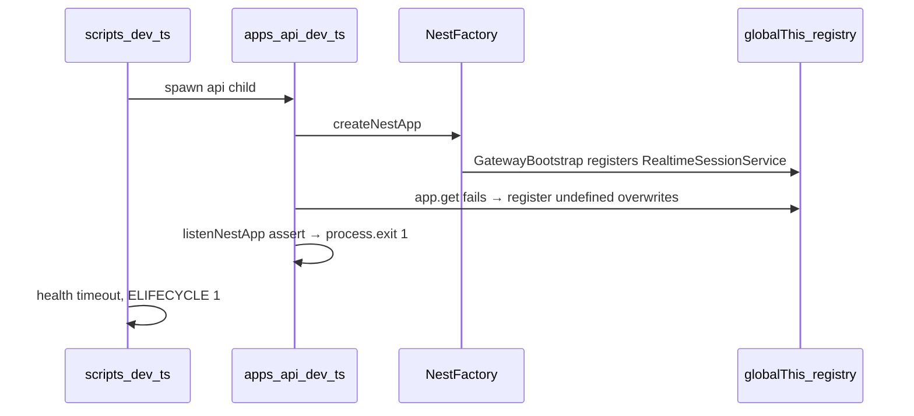

# Session: Collab + Realtime Deep Fix (2026-05-21)

This document records the collaborative editing (Hocuspocus/Yjs) and Socket.IO realtime work, how problems were diagnosed, what was changed, and how to verify locally.

## Symptoms (before fix)

| Area | Symptom |
|------|---------|
| **Document editor** | Footer showed offline/unsaved; typing did not sync across browsers |
| **Browser console** | `[collab] connect timed out`; awareness `count: 1`; WebSocket closed before established |
| **Collab server** | Often no `[collab] client connecting` / `[collab][auth] ok` despite server listening on 3002 |
| **API terminal** | `RealtimeSessionService is not available on this gateway instance (DI misconfiguration)` |
| **`pnpm dev`** | API exited after start with `RealtimeSessionService is not wired`; health poll failed; Vite never started |

## Debug evidence (session `833b60`)

Runtime logs showed two independent failure modes:

1. **Hocuspocus client lifecycle** — `connect-start` ran but `connect-timeout` followed ~4s later; collab auth logs were absent (handshake/path/lifecycle).
2. **Socket.IO DI** — `resolveSessionService` fallbacks were empty (`hasRegistry: false`, `hasStatic: false`, `hasModuleRef: false`) on handler instances Nest creates without constructor injection.

## Root causes

### A. Hocuspocus WebSocket URL

Hocuspocus v4 listens on the **TCP port root** (`ws://127.0.0.1:3002`), not a SPA-style path like `/collab`. Misconfigured `VITE_COLLAB_WS_URL=ws://127.0.0.1:3002/collab` prevented a successful handshake.

### B. Provider lifecycle (v3 design)

`use-collaborative-document-editor` created `HocuspocusProvider` in render with `token: ""`, fetched the token later, and called `provider.disconnect()` on bootstrap effect cleanup — racing Strict Mode and aborting in-flight connects.

### C. Socket.IO `RealtimeSessionService` resolution

Nest WebSocket invokes handlers on proxy instances **without** constructor DI. Class statics and a module-level registry were insufficient when duplicate ESM class identities appeared under `tsx watch`.

### D. Dev server kill switch (critical for `pnpm dev`)

In `nest-app-bootstrap.ts`, `app.get(RealtimeSessionService)` returned `undefined` (duplicate class token under `tsx`). That called `registerRealtimeSessionService(undefined)`, **overwriting** the valid registration from `RealtimeGatewayBootstrap.onModuleInit`. The post-listen dev assert then called `process.exit(1)`, so `scripts/dev.ts` never started web/collab/worker.



## Fixes implemented

### Track A — Hocuspocus / document editor

| Change | File(s) |
|--------|---------|
| Default WS URL `ws://127.0.0.1:3002` (no `/collab`) | `apps/web/src/lib/collab-ws-url.ts`, `.env.example`, `apps/web/.env.example`, `apps/collab/README.md` |
| **v3 deferred provider**: fetch `collab-token` first, then create `Y.Doc` + `HocuspocusProvider` with token+URL; single bootstrap effect keyed on `[sessionKey]`; cleanup clears timers only (no `disconnect()` on re-run) | `apps/web/src/hooks/use-collaborative-document-editor.ts` |
| Collab bootstrap / editor wiring | `collab-bootstrap.ts`, `DocumentEditor.tsx`, `editor-status-bar.tsx` |
| Dev collab JWT TTL extended in dev | `apps/api/src/auth/auth-session.service.ts` |
| Collab server bootstrap + auth extension | `apps/collab/src/main.ts`, `apps/collab/src/extensions/auth.extension.ts` |

### Track B — Socket.IO realtime DI

| Change | File(s) |
|--------|---------|
| `globalThis` registry for `INestApplication` + `RealtimeSessionService` | `apps/api/src/realtime/realtime-session.registry.ts` (new) |
| Register on bootstrap; resolve via registry → Nest app → ModuleRef → statics | `apps/api/src/nest-app-bootstrap.ts`, `apps/api/src/realtime/realtime.gateway.ts` |
| `RealtimeGatewayBootstrap` registers fallbacks on `onModuleInit` / `onApplicationBootstrap` | `apps/api/src/realtime/realtime-gateway.bootstrap.ts` (new), `realtime.nest.module.ts` |
| Post-listen dev assert: success if **any** resolution path works | `listenNestApp` in `nest-app-bootstrap.ts` |
| Unit tests: bare gateway + global registry + Nest app global | `tests/unit/api-realtime-gateway.test.ts` |

### Track C — Dev server not starting

| Change | Detail |
|--------|--------|
| `resolveRealtimeSessionService(app)` | Tries registry → `ModuleRef.get()` → `app.get()` |
| Register only when non-null | Avoids overwriting `RealtimeGatewayBootstrap` registration with `undefined` |
| Gateway `resolveSessionService` | Prefers `getNestApplication()?.get(ModuleRef)` before direct `app.get()` |

### Other touched areas

- `scripts/dev.ts` — minor dev orchestration
- `apps/web/package.json` — collab/editor dependencies
- Anchor decorations, routing, realtime payloads — related editor/realtime UX hardening

## Verification checklist

1. **Env** (repo root `.env`):
   - `VITE_COLLAB_WS_URL=ws://127.0.0.1:3002`
   - `COLLAB_WS_URL=ws://127.0.0.1:3002`
   - `CORS_ORIGINS` includes `http://127.0.0.1:8080` and `http://localhost:8080`

2. **Start stack**:
   ```bash
   pnpm dev
   ```
   Expect:
   - `[api] RealtimeSessionService wired for WebSocket handlers`
   - `[dev] API is healthy`
   - Vite at `http://127.0.0.1:8080`
   - Collab on port 3002

3. **Collab** (two browsers, same document):
   - Terminal: `[collab] client connecting`, `[collab][auth] ok`
   - Browser: `[collab] provider connect` → `provider synced`
   - Awareness `count: 2`; footer connected/synced

4. **Tests**:
   ```bash
   pnpm exec tsx --tsconfig apps/api/tsconfig.json --test tests/unit/api-realtime-gateway.test.ts
   ```
   Expect 12/12 pass.

5. **Health**:
   - `curl http://127.0.0.1:3001/api/v1/health` → 200
   - `curl http://127.0.0.1:3002/health` → 200

## Known operational notes

- **Docker port 5432**: If `pnpm dev` fails with “port already allocated”, stop the other Postgres or retry once compose containers are healthy.
- **API port 3001 in use**: Stop stale API before restarting `pnpm dev`.
- **Remaining issues**: User confirmed Hocuspocus integration is largely working; some features may still need follow-up (document in next session after user feedback).

## Key files reference

| Purpose | Path |
|---------|------|
| Collab hook (v3 lifecycle) | `apps/web/src/hooks/use-collaborative-document-editor.ts` |
| WS URL normalization | `apps/web/src/lib/collab-ws-url.ts` |
| API bootstrap + assert | `apps/api/src/nest-app-bootstrap.ts` |
| Realtime registry | `apps/api/src/realtime/realtime-session.registry.ts` |
| Realtime gateway | `apps/api/src/realtime/realtime.gateway.ts` |
| Gateway bootstrap | `apps/api/src/realtime/realtime-gateway.bootstrap.ts` |
| Collab server | `apps/collab/src/main.ts`, `apps/collab/src/extensions/auth.extension.ts` |
| Gateway tests | `tests/unit/api-realtime-gateway.test.ts` |

## Architecture (two realtime channels)

- **Hocuspocus** (`ws://127.0.0.1:3002`) — Yjs document sync + awareness (editor cursors, presence in document header).
- **Socket.IO** (`/realtime` on API) — workspace/task/document rooms, notifications-style events; separate from Hocuspocus.

Both required stable API startup (`pnpm dev`) and correct collab WS URL for end-to-end editor collaboration.
