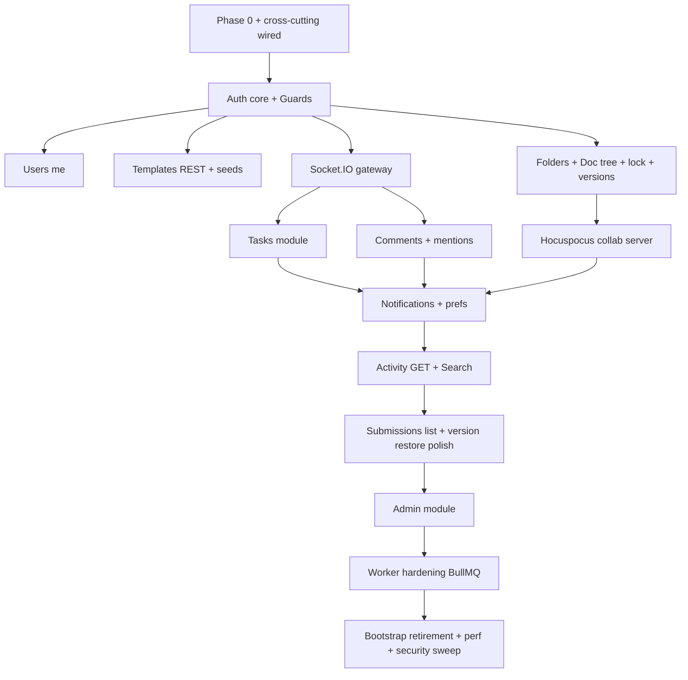

# CollabSphere Backend Roadmap (Plan, May 8 2026)

## 1. What we already have (commits up to `4583a3b`)

### Foundation (Phase 0)
- Monorepo + Docker Compose (Postgres 16, Redis 7, MailHog) at [docker-compose.yml](collabsphere-repo-recovery/docker-compose.yml).
- Prisma schema fully covers v1 domain entities at [packages/database/prisma/schema.prisma](collabsphere-repo-recovery/packages/database/prisma/schema.prisma) (User, Workspace, WorkspaceMember, WorkspaceSettings, Invitation, Folder, Document, DocumentVersion, DocumentSubmission, Task, TaskColumn, TaskDocumentLink, CommentThread, Comment, CommentMention, Notification, NotificationPreference, ActivityEvent, AuditLog, Template, File, ExportJob, Attachment, EmailDeliveryLog).
- Nest bootstrap shell at [apps/api/src/main.ts](collabsphere-repo-recovery/apps/api/src/main.ts) with `/api/v1` prefix and `ValidationPipe`.
- Cross-cutting building blocks already exist (but not yet wired globally into Nest): `common/filters/app-error.filter.ts`, `common/interceptors/response-envelope.interceptor.ts`, `common/interceptors/pagination.interceptor.ts`, `common/middleware/request-id.middleware.ts`, `common/logging/logger.module.ts`, `common/rate-limit/in-memory-rate-limiter.ts`, `common/prisma/*`.
- Bootstrap runtime [apps/api/src/dev.ts](collabsphere-repo-recovery/apps/api/src/dev.ts) still serves health, pagination fixtures, register, verify-email — kept as fallback during migration.

### Nest modules landed
- `HealthNestModule` — health endpoint.
- `AuthNestModule` — `POST /auth/register`, `POST /auth/verify-email` (other auth endpoints still in bootstrap runtime).
- `WorkspacesNestModule` — list, create (with template apply), get, update settings, archive/unarchive, delete, transfer-ownership; members list, role change, remove. RBAC centralized in [apps/api/src/workspaces/workspaces.policy.ts](collabsphere-repo-recovery/apps/api/src/workspaces/workspaces.policy.ts).
- `InvitationsNestModule` — create, preview by token, accept, resend, revoke.
- `DocumentsNestModule` — create (with document-template apply + enforcement), list, get, update metadata, update content (with versioning + required-block enforcement), submit / request-changes / approve transitions with `document_submissions` + `activity_events` + `audit_log` telemetry.

### Templates
- Shared envelope parser at [apps/api/src/common/templates/template-schema.ts](collabsphere-repo-recovery/apps/api/src/common/templates/template-schema.ts) (v2 schema, format/metadata/properties/structure).
- Workspace template application engine at [apps/api/src/workspaces/workspace-template.application.ts](collabsphere-repo-recovery/apps/api/src/workspaces/workspace-template.application.ts) with variable substitution and default workspace settings.
- Document templates: blocks parser + enforcement of `requiredBlockTypes` in `documents.service.ts.updateDocumentContent`.

### Tests landed
- Unit: workspaces controller, invitations controller, workspaces policy, template schema, workspace template application, documents service. Lint/typecheck/test:unit pass.

---

## 2. What is missing (against `docs/spec/18-appendices/18.3-api-endpoint-index.md` + `docs/spec/16-execution/16.4-phase-plan.md`)

### Production-blocking gaps
- **No real auth in Nest**: every Nest controller resolves the actor from a dev-only `x-user-id` header in [apps/api/src/common/auth/request-user.ts](collabsphere-repo-recovery/apps/api/src/common/auth/request-user.ts). Login/refresh/logout/logout-all/resend-verification/forgot-password/reset-password/Google OAuth still missing or only in bootstrap runtime.
- **No `JwtAuthGuard`, `RolesGuard`, or `WorkspaceMembershipGuard`** in Nest.
- **Global Nest filter/interceptor not bound** in [apps/api/src/main.ts](collabsphere-repo-recovery/apps/api/src/main.ts); response envelopes use a hard-coded `"nest-request"` requestId placeholder.
- **No HTTP integration tests** for any Nest endpoint (services tested in isolation only).

### Endpoint gaps (Nest)
- `Users`: `GET /users/me`, `PUT /users/me`, `PUT /users/me/password`, optional avatar.
- `Templates`: `GET /templates`, `GET /templates/:id` (used by create-workspace wizard).
- `Folders`: create / rename / delete.
- `Documents`: `GET /documents/tree`, `DELETE /documents/:id`, lock/unlock, versions list, version restore, export job create + status, submissions list.
- `Tasks` (entire module): list/board/detail, create, update fields, assign, status+position transition, soft delete, bulk (P2).
- `Task ↔ Document Links`: list, follow.
- `Comments` (entire module): list, create, update, delete, resolve thread, mentions.
- `Notifications` (entire module): unread-count, list, mark-read, mark-all-read, preferences.
- `Activity`: `GET /workspaces/:id/activity` (events are already being emitted by document transitions, but no read endpoint exists).
- `Search`: `GET /search` over `content_plaintext` / FTS.
- `Admin` (entire module): overview, users CRUD-ish (deactivate/reactivate/revoke-sessions), workspaces admin, audit log read.

### Realtime gaps
- [apps/collab/src/dev.ts](collabsphere-repo-recovery/apps/collab/src/dev.ts) is a 30-line HTTP placeholder. Spec §10 + §16.4 Phase 6 require a real **Hocuspocus** server: JWT handshake, workspace-membership auth, document lock/status read-only enforcement, `onLoadDocument` / `onStoreDocument` against `documents.content_yjs`, coalesced persistence (2–5s).
- No **Socket.IO** gateway in `apps/api`. Spec §10 + §16.4 Phase 5 require app-event fanout (notifications, tasks, comments, activity) with rooms `workspace:<id>`, `user:<id>`, optional `task:<id>`.

### Worker / async infra gaps
- [apps/worker/src/dev.ts](collabsphere-repo-recovery/apps/worker/src/dev.ts) only runs the verification-email processor and a heartbeat. No BullMQ. Missing jobs: due-soon / overdue task reminders, export rendering (PDF + Markdown), plaintext derivation / search index refresh, cleanup / retention.

### Hardening gaps
- Rate limiter is in-memory only; spec calls for Redis-ready abstraction.
- Bootstrap runtime in `apps/api/src/dev.ts` still serves register/verify-email/health/pagination — needs retirement once Nest reaches parity.
- No load/perf, security sweep, or OWASP baseline scan documented yet.

---

## 3. Critical-path dependency map

---

## 4. Prioritized execution order

Each sprint follows the established pattern: read-and-cross-check → plain-English plan → step-by-step implementation → unit tests → lint/typecheck/test:unit → log in `new dec/` → commit. Estimates are calendar days for one focused contributor.

### Sprint 1 — Quality lock-in on what we just shipped (1–2 days, **do first**)
- Bind `AppErrorFilter`, `ResponseEnvelopeInterceptor`, `RequestIdMiddleware`, and `LoggerModule` globally inside [apps/api/src/main.ts](collabsphere-repo-recovery/apps/api/src/main.ts) + [apps/api/src/app.module.ts](collabsphere-repo-recovery/apps/api/src/app.module.ts) so every Nest response carries a real `x-request-id`, structured envelope, and catalog-aware error mapping (replacing the `"nest-request"` placeholder).
- Add HTTP-layer integration tests (using `@nestjs/testing` + `supertest`) for: workspace list/create, invitation accept, document create/update-content/submit/approve, including envelope and error shape parity.
- Update `tests/tsconfig.json` decorators support if needed.
- Doc: `new dec/29-phase1-nest-cross-cutting-and-http-tests-2026-05-09.md`.

### Sprint 2 — Auth core + Guards (3–5 days, **production blocker**)
- Move `login`, `refresh`, `logout`, `logout-all`, `resend-verification`, `forgot-password`, `reset-password`, `google` + `google/callback` from bootstrap into `AuthNestModule`.
- Implement `JwtAuthGuard`, `@CurrentUser()` decorator, `@Roles()` decorator + `RolesGuard`, and `WorkspaceMembershipGuard`. Replace all `resolveRequestUserId(x-user-id)` usages with the real guards.
- Bridge rate-limit abstraction so it accepts a Redis-backed driver (still default in-memory locally).
- Doc: `new dec/30-phase2-auth-core-and-guards-2026-05-1x.md`.

### Sprint 3 — Users + Templates REST + valid seed catalog (1–2 days)
- `UsersNestModule`: `GET /users/me`, `PUT /users/me`, `PUT /users/me/password`.
- `TemplatesNestModule`: `GET /templates`, `GET /templates/:id` (used by the create-workspace wizard already in `apps/web`).
- Seed at least these **valid** templates per [packages/database/prisma/seed.mjs](collabsphere-repo-recovery/packages/database/prisma/seed.mjs):
  - workspace templates: `general-blank`, `professional-team`, `academic-thesis`, `academic-coursework`.
  - document templates: `meeting-notes`, `project-brief`, `thesis-chapter`, `coursework-assignment` — each enforcing required blocks per `template-schema.ts`.
- Doc: `new dec/31-phase2-users-templates-seeds-2026-05-1x.md`.

### Sprint 4 — Folders + Documents tree + lock/unlock + delete + versions (2–3 days)
- `FoldersNestModule`: create / rename / delete (block deletion when non-empty per §5.4.12).
- Extend `DocumentsNestModule`: `GET /documents/tree`, `DELETE /documents/:id` (soft delete + status guard), lock/unlock (Manager+), `GET /documents/:id/versions`, `POST /documents/:id/versions/:versionId/restore` (creates `before_restore` snapshot first), `GET /documents/:id/submissions`.
- Doc: `new dec/32-phase3-folders-doctree-locks-versions-2026-05-1x.md`.

### Sprint 5 — Hocuspocus collaboration server (3–5 days, **critical path**)
- Replace [apps/collab/src/dev.ts](collabsphere-repo-recovery/apps/collab/src/dev.ts) with a real Hocuspocus 2.x server:
  - JWT handshake using the same secret as `apps/api`.
  - `onAuthenticate`: workspace membership + document not-deleted check.
  - Read-only join when document is locked/submitted/approved or actor is Viewer.
  - Room naming `doc:<documentId>`.
  - `onLoadDocument` reads `documents.content_yjs`; `onStoreDocument` persists `content_yjs`, `content_plaintext`, `updated_at`, `updated_by` with debounce 2–5 s / on disconnect.
  - Optional awareness/presence hook.
- Add unit tests for the auth/load/store hook policies.
- Doc: `new dec/33-phase4-hocuspocus-collab-server-2026-05-1x.md`.

### Sprint 6 — Socket.IO app gateway (2–3 days, **critical path**)
- Add `RealtimeNestModule` in `apps/api` using `@nestjs/platform-socket.io` (or Express + socket.io adapter):
  - JWT handshake.
  - Rooms `workspace:<id>`, `user:<id>`, optional `task:<id>`.
  - Emit `task:*`, `comment:*`, `notification:*`, `activity:*` per §10 and §5.5.13.
  - Redis adapter scaffold (single-node first, multi-instance ready).
- Wire the existing service-side `activity_events` emitter to also publish to Socket.IO.
- Doc: `new dec/34-phase4-socketio-gateway-2026-05-1x.md`.

### Sprint 7 — Tasks (3–5 days)
- `TasksNestModule` per §5.5.14: `GET ?view=board|list`, `POST`, `GET /:id`, `PATCH /:id`, `PATCH /:id/assign`, `PATCH /:id/status` with state machine (§5.5.4.2), soft `DELETE`. Defer bulk to P2.
- Reuse `TaskColumn` rows already created by the workspace template engine.
- Emit Socket.IO + activity + audit on every change.
- Doc: `new dec/35-phase4-tasks-2026-05-1x.md`.

### Sprint 8 — Comments + mentions (2–3 days)
- `CommentsNestModule` per §18.3: thread + replies, resolve (Manager+), mention parsing into `CommentMention`, emit Socket.IO + activity.
- Doc: `new dec/36-phase4-comments-mentions-2026-05-1x.md`.

### Sprint 9 — Notifications + preferences + reminder worker (2–3 days)
- `NotificationsNestModule`: unread-count, list, mark-read, mark-all-read, preferences (`notification_preferences`).
- New `apps/worker` job (BullMQ): `task.due_soon` / `task.overdue` cron emitter; honors per-user notification preferences.
- Doc: `new dec/37-phase4-notifications-and-reminders-2026-05-1x.md`.

### Sprint 10 — Activity GET + Search (2–3 days)
- `ActivityNestModule`: `GET /workspaces/:id/activity` with cursor pagination over the events we are already writing.
- `SearchNestModule`: `GET /search` against `content_plaintext` (documents) + `tasks.title/description` using Postgres FTS; index migrations already exist in schema.
- Doc: `new dec/38-phase4-activity-search-2026-05-1x.md`.

### Sprint 11 — Admin module (3–5 days)
- `AdminNestModule` per §18.3: overview, users (deactivate / reactivate / revoke-sessions), workspaces (list / detail / archive / unarchive / force delete), audit log read with filters.
- Global admin guard (`@AdminOnly`).
- Doc: `new dec/39-phase5-admin-2026-05-1x.md`.

### Sprint 12 — Worker hardening + Export pipeline (2–3 days)
- Promote `apps/worker` to BullMQ-backed processors with retries, backoff, DLQ.
- Implement export job: queue + PDF (Playwright/Chromium) + Markdown (ProseMirror→MD) → store in MinIO/local FS → return signed URL via `GET /exports/:id`.
- Plaintext derivation / search-index refresh job.
- Doc: `new dec/40-phase5-worker-hardening-export-2026-05-1x.md`.

### Sprint 13 — Bootstrap retirement + perf + security sweep (2–3 days)
- Switch `apps/api` `dev` script to `tsx watch src/main.ts` (Nest), delete `apps/api/src/dev.ts` once parity tests pass.
- Light load tests against API + Hocuspocus + Socket.IO.
- Security checklist: JWT rotation, CSRF on cookie flows, rate limits on auth endpoints, room-join authorization audit, OWASP baseline.
- Doc: `new dec/41-phase5-bootstrap-retirement-hardening-2026-05-1x.md`.

---

## 5. What can wait (explicitly deprioritized for v1)
- Bulk task operations (§5.5.11) — P2.
- Files & Attachments full module (§18.3 marked v1.1).
- Workspace export (zip) — v1.1.
- Rich structured diff viewer for versions — v1.1 (basic plaintext diff is acceptable in v1).
- Calendar / timeline / dependency views in tasks — P3.
- Task labels normalization — keep `text[]` on `tasks` for v1, defer normalized table.
- Outline / slash commands / images in editor — P2.

---

## 6. Recommended next concrete action

Do **Sprint 1** (quality lock-in) immediately because it:
- Costs ~1 day,
- Removes the `"nest-request"` placeholder requestId from every response we just shipped,
- Adds the first HTTP integration tests proving canonical envelopes for workspace/invitation/document flows,
- Unblocks Sprint 2 (which can now layer guards into a properly wired Nest pipeline).

Then proceed to **Sprint 2 (Auth core + Guards)**, which is the largest single production blocker because every subsequent module has to depend on a real `JwtAuthGuard` + `WorkspaceMembershipGuard` instead of the dev-only `x-user-id` header.